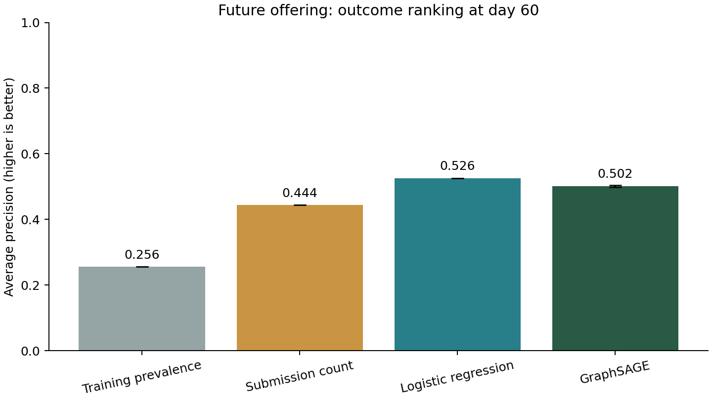
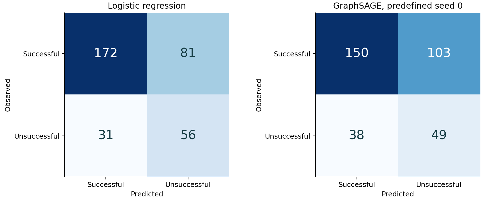
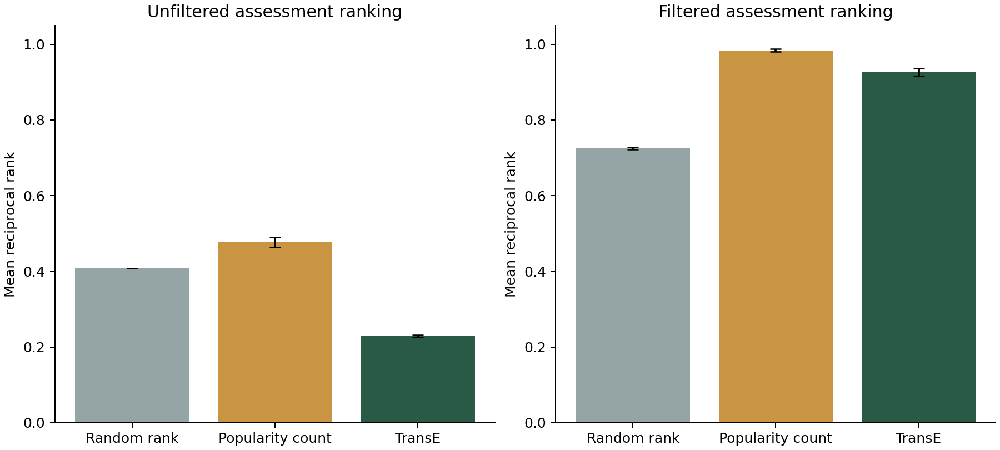

# Understanding the OULAD project

**What we built, what the results mean, and how we handled challenges and errors.**

Prepared on **14 October 2026**, updated through Session 6 on **18 October 2026**. This guide explains the saved earlier stages and the newly executed PostgreSQL integration. Section 16 covers mappings and virtualization; section 17 explains the learning methods, original counts, model results, leakage checks and limitations.

> **The main result:** we have a traceable education knowledge graph, an ontology that derives useful classifications, and a validation gate that catches structural errors while retaining documented missing values. The current full SHACL report has **0 violations and 5 warnings**, and **37 verification checks pass**.

## 1. What problem are we solving?

OULAD originally consists of separate CSV tables. A question such as “Which enrollments have a low assessment score?” requires joining student, offering, enrollment and assessment information correctly.

Our project represents these relationships explicitly, gives them clear meanings, and checks that the resulting graph follows our rules. It applies the lab techniques to education data while retaining the existing **M2ENV** Conda environment and the agreed project folders.

We selected module **AAA**, an anonymized Social Sciences module, across **2013J and 2014J**. A presentation is one offering of a module. AAA's real title, assignment content and instructors are not provided. The [AAA explanation](aaa-module.md) contains the detailed source interpretation.

Three different questions guide the work:

| Question | Tool or layer that answers it |
|---|---|
| What is explicitly recorded? | CSVs, RDF facts and SPARQL |
| What follows logically from those facts and our definitions? | RDFS/OWL and the reasoner |
| Does the supplied graph satisfy explicit data requirements? | SHACL and the project gate |

An enrollment can be logically consistent in OWL while failing a SHACL completeness check. These layers have different purposes.

## 2. What we did, in order

| Stage | Work completed | Why it matters |
|---|---|---|
| Download | Retrieved the seven OULAD CSVs and recorded source information, sizes and SHA-256 fingerprints. | We can identify the original inputs and detect later file changes. |
| Select | Kept AAA's two offerings and their related rows in separate interim files. | A small connected extract is easier to explain and validate. |
| Profile | Inspected distributions, missing values, candidate keys, references and value ranges. | Problems in source tables should be understood before conversion. |
| Model | Distinguished Student, Module, CourseOffering, Enrollment, Assessment, AssessmentRecord and LearningResource. | The graph respects the different meanings and identities in the data. |
| Convert to RDF | Created stable identifiers, links and typed values from the selected tables. | Questions can follow explicit relationships instead of repeatedly reconstructing joins. |
| Add RDFS | Declared classes, subclasses, domains and ranges. | The vocabulary becomes interpretable and supports basic entailment. |
| Query and verify | Answered competency questions and compared graph answers with CSV/SQL results. | We checked that the conversion preserves the intended answers. |
| Add database views | Loaded a property-graph projection into Neo4j and RDF/schema into Fuseki. | The same data can be explored visually and queried through a server. |
| Add OWL | Authored formal class definitions, reused a small FOAF fragment and ran HermiT through Owlready2. | The ontology can classify records and expose contradictory modeling commitments. |
| Add SHACL | Defined explicit graph constraints, review warnings, target checks and a blocking gate. | The pipeline can reject malformed data rather than merely describe its meaning. |
| Record provenance | Wrote the human-readable guide, fingerprints and PROV-O records for SHACL and integration runs. | Results can be connected to their inputs, software and activity. |
| Add Session 5 integration | Loaded PostgreSQL and reused one R2RML mapping with Morph-KGC and Ontop. | Saved and virtual graphs preserve the existing questions; committed changes demonstrate freshness. |

The current main pipeline places SHACL **immediately after RDF conversion and before answering questions**. Neo4j, Fuseki and full OWL reasoning remain explicit separate steps. The full command sequence is in the [README](../README.md).

## 3. What data do we actually have?

| Measure | Result | Correct interpretation |
|---|---:|---|
| Modules | 1 | The selected module is AAA. |
| Offerings | 2 | The same module is offered in two presentations. |
| Distinct student IDs | 712 | Count of different recorded people. |
| Enrollments | 748 | Count of participation records, each tied to one offering. |
| Assessments | 12 | Ten tutor-marked assessments and two exam definitions. |
| Assessment records | 3,149 | Recorded student-assessment results, including banked results. |
| Resource descriptions | 413 | Descriptions of available resources, not evidence that each was accessed. |
| Asserted RDF triples | 28,470 | Explicit statements produced by conversion. |
| Separate RDFS triples | 105 | Vocabulary statements describing classes and properties. |

**Why are there 748 enrollments but only 712 students?** Thirty-six student IDs appear in both offerings. A student is therefore a different entity from an enrollment. A repeated student may have a different outcome in each offering.

The seven types of project entities above account for **5,037 named entities** in total. This explains the corresponding Neo4j node count and the number of individuals classified in the full ontology run. A node can have many triples and several class memberships, so these counts need not equal the number of triples or inferred types.

Daily interaction data were downloaded but excluded from the core graph. The optional activity query is marked **unavailable**. That status does not tell us whether the students studied or clicked resources; it tells us those facts were not loaded.

## 4. How to read the graph

The main relationship pattern is:

```text
Enrollment --hasStudent--> Student
Enrollment --inOffering--> CourseOffering --offeringOf--> Module
AssessmentRecord --recordForEnrollment--> Enrollment
AssessmentRecord --forAssessment--> Assessment --assessmentInOffering--> CourseOffering
LearningResource --resourceInOffering--> CourseOffering
```

The record for student `100893` in AAA/2013J is identified by:

```text
https://example.org/oulad/id/enrollment/AAA/2013J/100893
```

Its recorded final result is Pass. This fact belongs to that enrollment. We do not turn it into a timeless statement that the person always passes.

The RDF mapping preserves several distinctions:

- Identifiers are strings or IRIs, rather than quantities to average.
- Scores are decimal values and banked flags are Booleans.
- Day values are signed integer offsets relative to the offering, so a negative registration day is meaningful.
- A missing optional value produces no property assertion. It is not replaced by zero, false or the text `nan`.
- A banked assessment result can come from an earlier presentation. `AssessmentRecord` is therefore a more accurate name than assuming every row is a fresh submission.

## 5. What the analytical answers mean

| Answer | Result | Interpretation and limit |
|---|---:|---|
| Enrollments in 2013J | 383 | Participation records for that offering. |
| Enrollments in 2014J | 365 | Participation records for the later offering. |
| Recorded late assessment records | 815 | Nonbanked records with both dates known and submission strictly after the recorded deadline. |
| Known scores below 40 | 90 | Low-scoring assessment records; multiple records may concern one enrollment. |
| Enrollments with at least one low score | 75 | Different enrollments associated with those 90 records. |
| Unknown scores | 3 | The records exist, but their marks are not supplied. |
| Banked assessment records | 42 | Results flagged as transferred from an earlier presentation. |

The 815 late records are not 815 different students. A same-day submission is excluded from “late,” and banked results are excluded. The result does not account for individual extensions or establish misconduct.

The 90 low scores do not imply 90 final module failures. A final outcome is recorded separately. If expressing the low-score proportion, the known-score denominator is **3,146**, giving **90 / 3,146 = 2.86%**. Including the three unknown scores in a “known score” denominator would be misleading.

Final outcomes are:

| Outcome | 2013J | 2014J | Both offerings |
|---|---:|---:|---:|
| Pass | 258 | 229 | 487 |
| Distinction | 20 | 24 | 44 |
| Fail | 45 | 46 | 91 |
| Withdrawn | 60 | 66 | 126 |
| Total | 383 | 365 | 748 |

Our definition of success is Pass or Distinction: **487 + 44 = 531 successful enrollments**. Using all enrollments, including withdrawals, the proportion is **531 / 748 = 70.99%**. It is 72.58% for 2013J and 69.32% for 2014J under the same definition. These describe this selected extract; they do not explain why the proportions differ.

Evidence: [enrollment answers](../outputs/answers/01_enrollments.csv), [outcomes](../outputs/answers/05_outcomes.csv), [late-record query](../queries/03_late_records.rq) and [ontology class counts](../outputs/ontology/inferred-class-counts.csv).

## 6. What the ontology added

RDFS provides the basic hierarchy. For example, a TutorMarkedAssessment is an Assessment, and a Student is a Person. OWL adds richer definitions and commitments, including disjoint classes, inverse properties, qualified cardinality and class equivalences.

The ontology aligns the project's Person class with a documented fragment of FOAF containing Person and Agent. It does not import every FOAF axiom or claim a complete BFO alignment.

| Inferred class | Count | Meaning |
|---|---:|---|
| SuccessfulEnrollment | 531 | Enrollment with recorded outcome Pass or Distinction. |
| WithdrawnEnrollment | 126 | Enrollment with recorded outcome Withdrawn. |
| LowScoreAssessmentRecord | 90 | Assessment record with a known score strictly below 40. |
| BankedAssessmentRecord | 42 | Record with the banked flag explicitly true. |
| NonBankedAssessmentRecord | 3,107 | Record with that flag explicitly false. |
| EnrollmentWithLowScore | 75 | Enrollment linked to at least one low-score record. |

For enrollment `AAA/2013J/100893`, the CSV supplies Pass, the RDF supplies the enrollment and its outcome, and the OWL definition supports classifying it as SuccessfulEnrollment. The inference follows from our definition and the existing fact; it is not a future prediction.

HermiT classified **5,037 named individuals** and the exporter saved **6,119 additional named type assertions**. These are extra classifications, not 6,119 new people or newly collected observations. The export is limited to named types and is not the complete OWL deductive closure.

The clean ontology and loaded facts are **consistent**, and no named class is unsatisfiable in the saved full run. Consistency means the axioms and facts can hold together under the model. It does not establish that the dataset is complete or that every modeling assumption is true in the real world.

All **17 ontology checks passed**, including exact inferred identities against CSV expectations and controlled semantic examples. See [ontology verification](../outputs/ontology/verification.json) and the [readable ontology results](../outputs/ontology/ontology-results.html).

## 7. What SHACL added

The shapes describe requirements for the supplied graph. Examples include exactly one Student link per Enrollment, a present score within [0,100], a Boolean banked flag, and agreement between the offering of an assessment and the offering of the corresponding enrollment.

We used SHACL Core for counts, datatypes, ranges, allowed values, forbidden properties, subtype alternatives and the comparison between registration and withdrawal dates on the same enrollment. SHACL-SPARQL handles checks across distinct records or linked paths, including duplicate contextual keys and cross-offering relationships.

The validator uses asserted RDF plus the RDFS hierarchy with automatic inference disabled. SHACL can still recognize subclasses for class targets and class checks. We avoid domain/range materialization because it could give an incorrectly typed object the very type we want to check explicitly.

There are **14 target-bearing shapes**. Thirteen have focus nodes in the core build. The optional DailyInteraction shape has none because activity was not loaded. The validator prints the counts, and the full verification compares seven structural entity counts with independent CSV-derived expectations.

### Reading a validation result

| Report field | Meaning | Example |
|---|---|---|
| Focus node | The entity under inspection. | `assessment-record/260355/1754` |
| Path | The property involved. | `edu:score` |
| Constraint | The requirement that produced the result. | `MinCountConstraintComponent` |
| Severity | The project's triage category. | Warning |
| Message | The interpretation or review action. | Keep the unknown score absent; do not replace it with zero. |

Open the [full HTML report](../outputs/shacl/full/report.html). The CSV and Turtle versions retain the detailed results for inspection or another tool.

### Why “conforms False” and “gate PASS” can appear together

The strict validator reports `conforms=False` when validation results are present, including warnings. Our pipeline makes a separate policy decision:

```text
No violations + no unknown severities + no empty required targets
    -> project gate passes
```

Warnings remain visible for review. A gate pass therefore means that the supplied graph meets our blocking requirements; it does not mean that the graph has no limitations or that every possible rule has been checked.

| Exit code | Meaning | What to do |
|---|---|---|
| 0 | Gate passes. | Read any warnings before interpreting the answers. |
| 1 | Gate fails. | Inspect violations and required-target coverage. |
| 2 | Execution error. | Check missing files, parsing, shapes or dependencies; no successful validation is established. |

After an execution error, an older report may still exist in the output folder. Check the command's exit code, report timestamp and run ID before treating that report as current.

## 8. The exact SHACL results and their interpretation

| Experiment | Scope | Violations | Warnings | Strict conforms | Gate |
|---|---|---:|---:|---|---|
| Full graph, triaged shapes | All 28,470 asserted facts plus schema | 0 | 5 | False | PASS |
| Real sample, triaged shapes | 299 unchanged source triples plus schema | 0 | 3 | False | PASS |
| Broken-link sample | Same sample with one Student link changed | 1 | 3 | False | FAIL |
| Naive first draft | Real sample; missing scores/deadlines treated as violations | 3 | 0 | False | FAIL |

The full graph's five warnings are:

| Focus node suffix | Missing property | Treatment |
|---|---|---|
| `assessment-record/260355/1754` | Score | Keep the record and its unknown mark. |
| `assessment-record/2606802/1760` | Score | Same treatment. |
| `assessment-record/721259/1752` | Score | Same treatment. |
| `assessment/1757` | Exact exam deadline | Keep the exam definition and leave the date unknown. |
| `assessment/1763` | Exact exam deadline | Same treatment. |

These exact identities match missing values in the selected CSVs. The sample has only three warnings because it contains one of the unknown-score records and both exam definitions.

The first draft and triaged sample use the **same data**. The change is the severity assigned to those three absences after reviewing their meaning. We did not delete the affected records or invent replacement values to make the report pass.

The broken sample changes the Student link on enrollment `AAA/2013J/100893` to an untyped teaching identifier. The resulting Class violation is expected. It demonstrates that a malformed relationship stops the gate while known completeness warnings remain visible.

The current full run took approximately **three minutes** on this machine. The small examples took about one second each in the latest saved run. Runtime depends on the machine and concurrent work; the cross-record SPARQL checks are more expensive than simple datatype or range checks.

## 9. Actual challenges and how they were addressed

This section records the challenges supported by the project files and implementation history. It is not a complete terminal transcript. Deliberate teaching faults are listed separately in the next section.

| Challenge or actual issue | Why it mattered | Response and remaining limit |
|---|---|---|
| Repeated students across offerings | A student ID alone cannot identify a participation record or its outcome. | Created contextual Enrollment IRIs using module, offering and student. Verified 712 people versus 748 enrollments. |
| Large daily-activity table | Including activity would substantially enlarge the first graph and distract from the core joins. | Retained the original download but left activity out of the core build. Its question is explicitly unavailable. |
| Missing scores and exam dates | Imputing zero or a date would invent facts and distort queries. | Preserved absence, kept the records and recorded warnings. This documents the limitation; it does not recover missing values. |
| Exam definitions without exam result records | A defined exam is not evidence that every student's result is available. | Modeled assessments separately from assessment records. No rule requires an exam mark for every enrollment. |
| Banked results and lateness | A banked result is not necessarily a new submission in that offering. | Required `isBanked=false` for the late-record query, with both dates known. |
| Negative day values | Treating all negative numbers as errors would reject valid pre-start registration/activity. | Kept signed integer offsets and tested negative-day examples. |
| Assignment and exam weights | Summing both groups could appear to produce an invalid 200% total. | Validated individual percentages; did not invent a formula combining the separate weighting schemes. |
| Confusing inference with validation | RDFS domain/range statements can add types rather than reject a bad link. OWL can permit unstated fillers. | Retained reasoning for meaning and added explicit SHACL constraints for supplied data. Validation disables domain/range materialization. |
| FOAF import compatibility warning | Loading the full vocabulary through Owlready2 raised a property-kind warning for `foaf:name`. | Cached the original, documented the issue and imported only the relevant Person/Agent fragment. Results apply to that selected fragment. |
| Windows ontology-loading path handling | Owlready2's `file:///C:/...` handling was problematic for the loader. | Serialized the merged graph to N-Triples and loaded a `BytesIO` file object, as documented in the reasoner code. |
| Enumerating RDF instances in Owlready2 | RDF class assertions need not explicitly declare `owl:NamedIndividual`. | Added declarations to a temporary loading graph so the reasoner can enumerate instances. Original source facts remain unchanged. |
| Local ontology imports | A missing or unresolved import could change the knowledge available to the reasoner. | Used a local catalog and fail when an import is absent from it. Retained the FOAF snapshot and fingerprints. |
| Fuseki dataset creation rejected by the lab admin interface | The browser/admin creation route was unavailable under the lab configuration. | Added `/oulad` through a project startup configuration while preserving `/kr` and the persistent volume. Import, query parity and restart persistence were checked. |
| Different graph representations | Neo4j labels/properties, RDF triples and OWL class memberships do not have identical counts or semantics. | Imported a documented property-graph projection, retained IRIs and compared shared answers. Inherited labels are added explicitly by the importer. |
| A report could “pass” while targeting nothing | A misspelled class name can yield zero focus nodes and strict SHACL conformance True. | Added a project coverage gate and a deliberate zero-target test. Full verification also checks source-derived counts. |
| A record could lose its type triple | Class-only targeting might fail to inspect that record. | Added property-based targets alongside class targets, with explicit class requirements; tested a missing-type record. |
| Known source gaps versus blocking errors | Treating all missing values as violations made the naive sample fail without identifying malformed numbers or links. | Separated completeness warnings from structural/value violations, documenting each triage choice. |
| Zero could disappear from the readable result | An early value-extraction expression treated numeric zero like an absent value. | Replaced truthiness handling with an explicit `None` check. A test now confirms that an invalid zero offering length is reported with value `0`. |
| Slow full-graph validation | Repeated cross-record queries take much longer than small-example checks. | Kept a complete local gate and a small real-data fixture for fast practice/CI. Recorded runtimes rather than hiding the cost. |
| Reports can become stale after rerunning a stage | A new run changes timestamps, run IDs and output fingerprints, even if the data and result counts stay the same. | Verification checks the exact full-report fingerprint and current inputs. Rerun verification after validation; preserve output folders if earlier runs are needed. |
| Fields not represented in RDF | SHACL cannot inspect studied credits or resource week ranges absent from the mapping. | Kept those checks in Python profiling and documented the SHACL coverage boundary. |
| Source duplicates can collapse during conversion | RDF is a set of triples; repeated source rows can become indistinguishable after mapping to the same IRI. | Kept source key/duplicate checks before conversion and graph key checks across distinct nodes afterward. |
| Remote CI is a separate step | A local workflow file does not prove a GitHub run passed or prevent merging by itself. | Your screenshot shows the SHACL workflow succeeded at `afd8535` on main. The new integration workflow is prepared locally; branch protection remains a separate repository setting. |

The current issues that remain are primarily **documented missingness and scope limitations**. There is no outstanding blocking SHACL violation in the saved full graph. That statement concerns the implemented constraints, not every conceivable defect.

## 10. Deliberate errors: what we tested and learned

These are controlled examples, not errors found in real student records. The broken fixture and synthetic examples stay separate from the original data and database imports.

### Ontology experiments

| Deliberate setup | Expected outcome | Lesson |
|---|---|---|
| Use `hasStudent` as though its subject were a Student, while its domain is Enrollment and Person/Enrollment are disjoint. | The two constructed teaching classes are unsatisfiable. | Domains infer types, and those inferred types can conflict with disjointness. |
| Create an instance of one of those impossible classes. | The example ontology becomes inconsistent. | An empty impossible class differs from an asserted impossible individual. |
| Omit explicit Student/Offering links from an enrollment constrained by OWL exactly-one axioms. | The example remains consistent. | Open-world reasoning can allow unstated fillers. |
| Give one enrollment two student names, then explicitly declare the people different. | Equality can satisfy the first case; the explicit difference makes the restricted case inconsistent. | OWL does not assume every distinct name denotes a different individual. |
| Change the success definition from equivalence to subclass only. | The outcome no longer suffices to infer successful membership. | Necessary conditions alone are not a complete classification definition. |
| Use only-low records without a some-record condition. | No record existence is entailed by the universal restriction alone. | “Only” restricts possible values; “some” requires existence. |
| Test known scores 39, 40, 41 and an unknown score. | Only 39 is inferred low. | The low-score boundary is strict, and absence does not imply zero. |

### SHACL experiments

The tests remove required links, introduce two Student values, replace a typed link with an untyped identifier, use scores outside the permitted range, use wrong datatypes, duplicate contextual keys and connect records across different offerings. They also test unsupported assessment types, misplaced final outcomes, reversed dates, negative counts and missing type triples.

Each test checks that the validator reacts **as expected**. A test of an invalid score passes when the shape flags that invalid score. It does not mean that the invalid score was accepted.

Valid boundaries are also tested: scores 0 and 100 remain allowed, known negative day offsets remain allowed, and zero clicks remain allowed. Unknown scores remain warnings. This helps prevent a validator that rejects legitimate observations while catching bad ones.

## 11. What the verification establishes

| Layer | Passed checks | What was checked |
|---|---:|---|
| Core CSV/RDF pipeline | 14 | Counts, outcome answers, exact late-record identities and day differences against SQL, missing-value retention and query boundaries. |
| OWL ontology | 17 | Consistency/coherence, exact inferred identities against CSVs, vocabulary alignment, sample fidelity and reasoning semantics. |
| PostgreSQL integration | 23 per dataset | Graph equality, six SQL/RDF/virtual answer comparisons, generated SQL, SQL constraints, SHACL and committed-update freshness. |
| SHACL extension | 37 | Valid/broken behavior, value boundaries, link integrity, target coverage, sample fidelity, CSV warning identities, source fingerprints and PROV-O input/output fingerprints. |

These are counts of checks, not counts of defects or percentages of complete coverage. Several checks address related aspects of the same model. Passing the suite supports the specific properties tested.

The latest full SHACL result and its verification have matching report fingerprints when this walkthrough was prepared. The full run finished at **2026-10-15T02:51:37.486501+00:00** and the 37-check verification was recorded at **2026-10-15T02:51:53.178880+00:00** (UTC). The saved ontology report's input fingerprints also match the current ontology and data. The database counts below come from their earlier saved import checks; the Session 5 update did not recheck Neo4j or Fuseki. It did query the project PostgreSQL service through SQL and Ontop.

An appendix below lists all 37 SHACL checks from the verification file, so you can connect the summary to the exact evidence.

## 12. What Neo4j and Fuseki results mean

| Tool | Saved result | How to interpret it |
|---|---|---|
| Neo4j | 5,037 project nodes, 8,221 relationships; 815 late records. | A property-graph projection. RDF literal values become node properties, and selected types become labels. |
| Fuseki | 28,575 triples; all six available query result sets matched the local RDFLib results. | 28,470 data facts plus 105 RDFS schema triples in the default graph. Automatic RDFS inference is disabled. |
| Ontology notebook | Saved inferred class memberships, examples and explanations. | Local presentation of the reasoner evidence, with source fingerprints checked. |

The OWL inference export is separate from both database imports. It is not automatically present merely because the server contains an RDFS or OWL file.

For access, Neo4j's browser is on port **7474**, its driver/Bolt connection is on **7687**, and the configured Fuseki web service is on **3030**. The [README](../README.md) explains startup, loading and example queries. These are configured addresses, not a claim that the services are running now.

## 13. Provenance: how we know which run produced a result

There are three complementary records:

1. The [project provenance guide](project-provenance.html) explains data origins, transformations, authorship/reuse, decisions and limitations. Its JSON snapshot is a dated audit of files.
2. Each SHACL output folder contains `provenance.ttl`, recording a real validation activity with input entities, a software agent and generated report entities.

3. Each Session 5 run records the six CSVs, mapping, SQL schema, code, questions, runtime download manifest, database fingerprint and generated outputs in its own `provenance.ttl`.

The validation run uses the data, schema and shapes; it records their SHA-256 fingerprints. The validator is identified by its code fingerprint and pySHACL version. The output report fingerprints are linked back to that run. Local start/end times are recorded in UTC.

A fingerprint helps identify changed bytes. It is not a publisher signature, proof of truth or an automatically preserved history. An unchanged graph can also acquire a different file fingerprint if its Turtle serialization is reordered.

During preparation of this explanation, a newer full validation run was observed, followed by a matching new 37-check verification. It retained the same 0-violation/5-warning outcome. This illustrates why a dated provenance snapshot and the current output directory can describe different runs without their counts disagreeing. The project-wide snapshot was refreshed on 16 October, retaining the previous snapshot in docs/history/. Each integration run also has a unique output directory and its own PROV-O record.

Run `python src/validation/show_provenance.py` to inspect the latest full validation record. Copy a run's output directory before rerunning if you need to preserve its historical reports. Per-triple provenance for the entire graph and an immutable history of every earlier stage have not been implemented.

**After moving the project:** the current project folder is `D:\DESKTOP\M2\kr-oulad`, with the course folder at `D:\DESKTOP\M2\KRR`. Earlier reports may still record the old `C:` locations because those were their inputs' locations when they ran. We preserve those historical records. To produce validation reports and verification for the new location, run the complete Session 4 sequence below; it regenerates the reports with current paths. Running only the verification against old reports may fail when their recorded absolute paths no longer exist. This walkthrough checks the saved verification fingerprints against the files at their new location; the current Session 4 reports date from 15 October. Session 5 separately validates its new mapped graph in its own run directory.

## 14. How to inspect and repeat the work

For understanding, open these in order:

1. [AAA data explanation](aaa-module.md): understand the observations and their limits.
2. [Ontology results](../outputs/ontology/ontology-results.html): see what the definitions infer.
3. [Full SHACL report](../outputs/shacl/full/report.html): inspect the five actual warnings and coverage counts.
4. [Broken example report](../outputs/shacl/broken/report.html): see the Class violation caused by the changed Student link.
5. [Draft report](../outputs/shacl/draft/report.html) and [triaged sample](../outputs/shacl/sample/report.html): compare severity changes on identical facts.
6. [SHACL triage decisions](shacl-triage.md): connect each rule to its justification.

To rerun the Session 4 demonstration:

```powershell
conda activate M2ENV
Set-Location 'D:\DESKTOP\M2\kr-oulad'
.\run-shacl.ps1
```

The helper expects the broken-link and naive-draft examples to return exit 1, and fails on unexpected outcomes. For the current full graph alone, use `python src/validation/validate.py`, followed by `python evaluation/verify_shacl.py` to reconcile that new run. The complete step-by-step instructions are in [README section 12](../README.md#12-session-4--shacl-validation-triage-and-gate).

The core project describes historical records. Session 6 now adds evaluated retrospective outcome models and a separate hidden-link reconstruction experiment; it has no natural-language interface yet. Final outcomes cannot be used as if they were known before a future prediction cutoff. The current SHACL work also does not claim completion of every separate Session 4 exercise, such as ontology version-IRI management.

## 15. A short explanation for your presentation

“We selected two offerings of OULAD module AAA and profiled their related tables. We represented the data as RDF, keeping people separate from contextual enrollments and preserving missing values. RDFS describes the vocabulary, and OWL definitions let HermiT classify records such as successful enrollments and low scores. We checked those identities against the CSVs. We then added SHACL requirements and a gate: the full graph has no blocking violations and five documented completeness warnings. Deliberately broken examples show that the gate catches faults. The README, reports and provenance records make the workflow reproducible and explain its limits.”

If asked why you did not simply remove the warnings, explain that a trustworthy graph should represent what is known and make missingness visible. A cleaner-looking report would not justify inventing marks or exam dates.

## 16. Session 5: one mapping, two ways to answer

The purpose is to show that a relational database can support our existing knowledge-graph questions in two ways. We can convert its rows to a saved graph, or query those rows through a virtual graph. PostgreSQL is the shared source; the R2RML file defines how relational keys, columns and joins become RDF identities, values and links.

```text
Six selected AAA CSVs → PostgreSQL tables and views
                                  │
                    one shared R2RML mapping
                         ┌────────┴────────┐
                         ↓                 ↓
                    Morph-KGC            Ontop
                         ↓                 ↓
                 saved RDF snapshot   SPARQL rewritten to SQL
                         ↓                 ↓
                   RDFLib + SHACL     live PostgreSQL answers
```

### What we built and why

The loader retains all columns in the six selected tables, uses composite keys for enrollments, adds foreign-key/range constraints and commits a complete load transactionally. SQL views reconstruct relationships. For example, studentAssessment supplies student and assessment IDs; joining assessments supplies the module/offering needed to link the result to the correct enrollment. A separate loader check rejects records without that enrollment. We never join only on student ID where an offering is also required.

The mapping constructs the same `https://example.org/oulad/id/` resources as the original Python conversion. Each `rr:logicalTable` selects rows; `rr:subjectMap` creates the subject; predicate-object maps emit values and relationship targets. This makes the transformation explicit and reusable by two engines. The database contains 2 offerings, 748 enrollment rows, 748 registration rows, 12 assessments, 3,149 assessment records and 413 resource rows. Its Student view deduplicates 712 student IDs.

**Materialization:** Morph-KGC reads the database and mapping, then writes 28,470 asserted triples. This is a snapshot at execution time. It can be stored, inspected or validated with the existing SHACL rules. It is different from computing new OWL class memberships.

**Virtualization:** Ontop translates each SPARQL query through the mapping into SQL and reads PostgreSQL. We retain the resulting CSV and generated SQL so you can inspect the translation. There is no need to populate a separate RDF store to execute these virtual queries. Returned answers are live relative to committed database state at query time, not a guarantee of one synchronized state across arbitrary concurrent requests.

### The questions and verified results

The full integration run **99568e1cd42b46aa8ddf05ac6d075a5b** started **2026-10-16T10:31:22.648570+00:00** and completed its checks **2026-10-16T10:33:10.438337+00:00** (UTC). All **23 checks passed**. The fixture independently passed the same 23 checks on 299 triples.

| Question file | Result rows | Comparison |
|---|---:|---|
| 01_enrollments | 2 | Same answers in all four paths |
| 02_assessments | 12 | Same answers in all four paths |
| 03_late_records | 815 | Same answers in all four paths |
| 04_low_scores | 90 | Same answers in all four paths |
| 05_outcomes | 8 | Same answers in all four paths |
| 06_unknown_scores | 3 | Same answers in all four paths |

The four paths are independent SQL, the original RDF conversion, mapped RDF and Ontop. We compare complete answer multisets, retaining duplicates while ignoring presentation order. Thus 815 means matching late-record answers, not just an equal total. The graph comparison also compares identities, predicates and typed values. Its raw-term difference is zero in this run; the comparator additionally documents equivalent RDF 1.1 string and numeric lexical forms.

Enrollment counts are grouped by offering; outcome rows are offering/outcome groups. The three unknown-score answers are preserved records whose score property is absent. Low scores and late records are historical observations, not causal explanations or predictions.

Question 2's original RDFS path is represented for Ontop by the explicit current assessment types TMA, CMA and Exam. Both versions return the same 12 assessments. No OWL ontology is passed to Ontop here; HermiT's Session 3 classifications remain a separately tested stage. Ontop's ontology support should not be equated with unrestricted OWL DL reasoning.

### How SHACL fits

The existing validator runs on the newly materialized graph plus the existing RDFS schema. It again reports **0 violations and 5 warnings**: three unknown scores and two unknown exam deadlines. The project gate passes with those visible warnings. The fixture has one unknown score and two unknown deadlines, so its warning count is three. A passing mapped graph does not prove every future virtual database state will pass: after changing source data, rematerialize and validate again.

The integration tests also attempt a duplicate enrollment key, an out-of-range score of 101, and an unknown offering. PostgreSQL rejects all three; each attempt is rolled back. SQL constraints protect the table state, while SHACL checks the graph produced by the mapping. Neither substitutes for the other.

### The change experiment, interpreted

| Stage | Low-score count | Meaning |
|---|---:|---|
| Original snapshot and virtual query | 90 | Both describe the original teaching copy. |
| Change one score to 99 and commit; query Ontop | 89 | One record no longer meets score < 40. |
| Query the old RDF snapshot | 90 | Saving a graph does not give it an automatic refresh mechanism. |
| Materialize again and query the new graph | 89 | A new snapshot reflects the committed update. |
| Restore the edited value | Original database fingerprint restored | The experiment leaves the teaching copy's data as it was. |

The experiment runs in a separate `oulad_demo` schema; the main AAA tables are unchanged. It illustrates freshness, not a general speed ranking. Query timings include local Java startup, and the source is small. The fixture performs the same experiment with counts 2 → 1. Before/after teaching artifacts remain clearly labeled and should not be mistaken for the original dataset.

### Actual implementation challenges and fixes

| Observed problem | Cause | Fix and evidence |
|---|---|---|
| Database fingerprint query failed with ORDER BY position 13 | The student_info table has 12 columns; a fixed positional sort was wrong. | Sort full rows by their JSON representation; then hash columns and rows deterministically. Both datasets now pass the load-state checks. |
| Fixture produced 300 triples rather than 299 | Morph emitted the text `None` as a decimal for a SQL NULL score. | A separate `KnownScores` mapping selects only non-NULL scores. It retains the record and its other links. Exact graph equality and unknown-score answers now pass. |
| Ontop rejected a Windows properties path as an invalid URI | Backslashes in a relative path were interpreted as URI syntax. | Pass forward-slash relative paths for mapping, properties, query and output arguments. All six virtual queries pass. |
| Lab dependencies exceed Morph's declared upper bounds | M2ENV uses newer RDFLib/PyOxigraph versions required by the course. | Install the pinned Morph package with `--no-deps`, keep the existing versions, and verify the actual mapping/query workload. CI explicitly reproduces this tested combination. |
| Need to compare changing database and saved graph meaningfully | Different source states can create a false mapping discrepancy. | Hold shared table locks during baseline comparisons; isolate intentional edits in a separate demo schema and restore the score in a finally block. |
| Need to distinguish successful checks from remote CI | Local execution does not demonstrate a GitHub runner result. | Record 23 local checks for each dataset; prepare the separate workflow and label its remote execution pending. The earlier SHACL workflow success is independently identified as user-supplied screenshot evidence. |

Failed implementation attempts retain their diagnostics in `outputs/integration/runs/`. The last-success pointers are updated only after every check and provenance verification succeeds. Known missing values remain documented limitations; no source value was invented to make the tests pass.

### How to run and inspect it

```powershell
conda activate M2ENV
Set-Location 'D:\DESKTOP\M2\kr-oulad'
.\run-integration.ps1
```

Open the [integration results](../outputs/integration/integration-results.html), inspect [this run's summary](../outputs/integration/runs/99568e1cd42b46aa8ddf05ac6d075a5b/summary.json), then follow a question's CSV and generated SQL links. Read [README section 13](../README.md#13-session-5--postgresql-mappings-materialization-and-virtualization) for prerequisites, individual commands, connection settings, fixture mode and troubleshooting.

The new [integration CI workflow](../.github/workflows/integration.yml) runs the committed fixture against PostgreSQL and retains evidence artifacts. It is prepared locally; no remote execution is claimed yet. The full data and its 28,470 triples are checked locally. The [provenance guide](project-provenance.html#12-session-5-integration-provenance) records exact inputs, software, database fingerprints and both successful run IDs.

For a presentation: “We now maintain one explicit relational-to-RDF mapping. Morph-KGC uses it to save a graph; Ontop uses it to answer SPARQL directly from PostgreSQL. We compared the graph and all six questions with the original pipeline, re-ran SHACL, and demonstrated why a saved graph needs refreshing after a committed source change.”

## 17. Session 6: learning, counts and an honest comparison

Updated **18 October 2026**. This chapter reports the actual run `f7649738f7414536bc2395ef7496eebf`. Its start and finish timestamps are **2026-10-17T21:32:30.408391+00:00** and **2026-10-17T21:33:16.413705+00:00** (UTC). It passed **21 learning checks** and **54 independently recomputed evidence checks**.

### The result first

For predicting eventual Fail/Withdrawn outcomes in the future offering, **logistic regression has the highest average precision among the tested valid models**: 0.526, compared with GraphSAGE's three-seed mean 0.502, the submission-count baseline 0.444, and the constant-score reference 0.256. This is a measured comparison on one cohort; no statistical claim of universal superiority follows.

For reconstructing hidden historical submission links, **the popularity-count baseline beats TransE in every seed**, both with and without filtering. A more complex method does not automatically help. That is a useful Session 6 finding, not an experiment to hide or tune away.

Open the [learning results report](../outputs/learning/learning-results.html) for charts and downloadable results. The [full run summary](../outputs/learning/runs/f7649738f7414536bc2395ef7496eebf/summary.json) contains every seed, split, model setting and count.

### 1. What does “initial count” mean here?

The original facts and the test population must have separate denominators:

| Population or stage | Enrollments | Successful: Pass/Distinction | Unsuccessful: Fail/Withdrawn |
|---|---:|---:|---:|
| Original AAA data | 748 | 531 | 217 |
| Original 2013J | 383 | 278 | 105 |
| Original 2014J | 365 | 253 | 112 |
| Eligible at day 60, both offerings | 701 | 531 | 170 |
| Eligible 2013J before student separation | 361 | 278 | 83 |
| Final training cohort, 2013J | 335 | 278 | 57 |
| Final test cohort, 2014J | 340 | 253 | 87 |

There are 47 withdrawals already recorded by day 60: 22 in 2013J and 25 in 2014J. They are excluded because predicting a withdrawal already known at the prediction time would be misleading. Everyone in this extract registered by the cutoff; the eligibility rule also handles not-yet-registered records. A withdrawal after day 60 is retained as a future outcome, while its date is excluded from the features.

There are 36 students in both original offerings. Of their 2013J enrollments, ten were already excluded by the cutoff rule and 26 remained eligible. We remove those 26 from training so no test student appears in training. All 26 had unsuccessful earlier outcomes. Consequently the training positive share falls to **17.0%**, whereas the test share is **25.6%**. This selection/prevalence difference is a real limitation, not something to conceal.

The models' predicted counts must therefore be compared with **87 unsuccessful outcomes out of 340 test enrollments**, not with all 217 historical unsuccessful enrollments. No model result changes the original 531/217 facts.

### 2. The two learning questions

**Node classification:** at day 60, among enrollments still registered, can early recorded behavior help rank eventual unsuccessful outcomes? The node is Enrollment, not Student: the outcome belongs to participation in one offering. The positive label 1 combines Fail and Withdrawn; label 0 combines Pass and Distinction. This does not distinguish causes or types of unsuccessful outcome.

**Link prediction:** after hiding some observed enrollment-to-assessment submission links, can the model rank the hidden true assessment? This uses historical nonbanked records across both offerings. It is a separate graph-completion benchmark, not a forecast of future participation and not an assessment recommendation system.

### 3. From RDF to safe model inputs

The runner reads the successful Session 5 materialized RDF, currently `outputs/integration/runs/7c0b60e5ae2b4e7da058f851b1c8286c/oulad-mapped.nt`. It checks its receipt and the selected CSV fingerprints before using it. If no integration result exists, it explicitly falls back to the original `data/processed/oulad.ttl`. The current run used the mapped graph. No live PostgreSQL, Neo4j or Fuseki service is needed during learning.

The classification builder permits only five candidate enrollment features:

| Feature | Meaning at day 60 |
|---|---|
| previous_attempts | Recorded number of previous attempts; later removed because it is constant in training. |
| registration_day | Signed day relative to the offering start; negative values remain meaningful. |
| early_submission_count | Number of nonbanked records with a known submission date on or before day 60. |
| early_late_count | Among those records, how many were after a known scheduled deadline. |
| last_submission_day | Latest recorded submission day in that permitted window; absent if no such record exists. |

Scores are deliberately excluded: the release gives submission dates, but no grade-publication timestamp proving which grades were available by day 60. Final outcomes, post-cutoff records, withdrawal dates, and OWL-derived SuccessfulEnrollment/WithdrawnEnrollment classes are also excluded. IDs locate rows and edges but are not numerical predictors or identity embeddings. Demographic fields and daily click activity are not used by this model.

The [learning RDF](../outputs/learning/runs/f7649738f7414536bc2395ef7496eebf/graph/learning-input.ttl) contains the permitted enrollment features and early-submission links, with assessment type, scheduled deadline and weight on neighboring assessment nodes. Labels are saved separately in `graph/labels.csv`. The whole historical graph is never fed indiscriminately to the GNN.

Missing last-submission values are filled with the **training median in the numeric feature matrix only**, and a missingness indicator is added. This does not invent an RDF submission or alter a CSV. The absence remains visible. The training-only pipeline then removes constant columns and standardizes values. Previous-attempt count is always zero in the temporal training cohort, so its effect cannot be learned there and it is removed from both models. Some future students are returning students; that remains a transfer limitation.

### 4. Why these techniques were chosen

**Training prevalence / majority baseline** uses no individual predictors. It assigns every row the training positive share, and at threshold 0.5 predicts successful for everyone. It provides the basic count/imbalance reference.

**Early-submission count baseline** ranks lower counts as greater risk. Its simple decision rule flags only zero-submission enrollments. The ranking and binary rule are deliberately explicit: two methods can use similar rankings but different thresholds and flag different numbers of cases.

**Logistic regression** is a small, inspectable tabular model. It learns a weighted combination of the permitted features. It uses balanced class weights, C=1 and a fixed threshold of 0.5. This gives a stronger baseline before claiming a graph neural network helps.

**GraphSAGE** follows the lab's message-passing idea. Two layers, each with 16 hidden dimensions, combine a node's own features with mean neighbor information. The implementation uses a bipartite PyTorch Geometric graph with enrollment/assessment node flags and edges in both directions. Neighbor assessment features are type, scheduled deadline and weight. It uses 100 epochs, Adam at 0.01 and a training-derived positive-class weight. There are no per-student identity embeddings.

For each split, the GNN's training graph includes only training enrollments and their permitted edges. The evaluation graph is separate. At inference, it can use other unlabeled enrollments in the same held-out cohort; it never receives their outcome labels or sends their messages through the training graph. Therefore this is cohort inference, not necessarily an isolated one-student-at-a-time service.

**TransE** follows the lab's embedding exercise: it learns vectors so head + relation is near tail. We use PyKEEN, dimension 32, 100 epochs, Adam at 0.01, batch size 256 and five sampled negatives per positive. It is compared with assessment popularity counted from training links only. Its library negative sampler corrupts entities and filters training positives; sampled unobserved links are training contrasts, not verified false statements under the open-world interpretation.

The [protocol](../config/learning/protocol.json) fixes settings and seeds. We did not search for a winning seed, tune the threshold on test labels or keep changing hyperparameters until a complex model won. Logistic regression is deterministic here; repeating its temporal fit with a different seed would not be a meaningful new experiment. GraphSAGE initialization and TransE partitions/training are each evaluated with seeds 0, 1 and 2.

### 5. Exact outcome results and how to read them

All rows below concern the same **340 test enrollments with 87 actual positives**:

| Method | Seed | Predicted unsuccessful | Average precision | Precision | Recall | Accuracy | Balanced accuracy |
|---|---:|---:|---:|---:|---:|---:|---:|
| Logistic regression | 0 | 137 | 0.526 | 40.9% | 64.4% | 67.1% | 66.2% |
| Training prevalence | 0 | 0 | 0.256 | 0.0% | 0.0% | 74.4% | 50.0% |
| Early submission count | 0 | 21 | 0.444 | 71.4% | 17.2% | 77.1% | 57.4% |
| GraphSAGE | 0 | 152 | 0.502 | 32.2% | 56.3% | 58.5% | 57.8% |
| GraphSAGE | 1 | 183 | 0.504 | 34.4% | 72.4% | 57.6% | 62.5% |
| GraphSAGE | 2 | 186 | 0.498 | 36.0% | 77.0% | 59.1% | 65.0% |



**Average precision (AP)** summarizes how well actual positives occur near the top of the ranking. Here the constant-score AP is 87/340 = 0.256. The implementation uses scikit-learn's `average_precision_score`; it is not trapezoidal area under a precision-recall curve. GraphSAGE's mean is **0.502**, population standard deviation across seeds **0.002**, and range **0.498–0.504**. These three seeds do not form a confidence interval for performance on other cohorts.

**The logistic-regression counts:** it flags **137**, of which **56** really have unsuccessful outcomes and **81** are false positives. It misses **31** of the 87 actual positives. Its precision is 56/137 = **40.9%**; its recall is 56/87 = **64.4%**. It overcounts positives by 50, but that total alone hides both missed cases and false alarms.

**The submission rule:** it flags 21, correctly identifies 15, generates six false positives and misses 72 actual positives. Its precision is higher (**71.4%**) but its recall is only **17.2%**. This is why a simple rule can have better accuracy and still miss most of the target cases.

**The majority baseline:** it gets 253/340 = **74.4% accuracy** by predicting successful for everyone. It finds none of the 87 positive outcomes. Balanced accuracy is 0.5. Accuracy is therefore insufficient to judge this task. The count rule has 77.1% accuracy, while logistic regression trades some accuracy for greater recall.

**The GNN:** it flags between 152 and 186 cases across seeds. Its ranking is above the count baseline but below logistic regression here. The count feature already summarizes a central part of the graph structure; AAA has few shared assessment nodes. This is a plausible explanation for limited added value, not a causal conclusion established by this experiment.



Rows are observed classes and columns are predicted classes. The off-diagonal cells are mistakes. GraphSAGE seed 0 is shown because it was predefined, not selected as the best seed. Class-weighted outputs are not established calibrated risk probabilities, and 0.5 is a reproducible teaching threshold rather than an operationally optimized decision policy.

### 6. What the logistic coefficients mean

| Standardized feature | Coefficient |
|---|---:|
| registration_day | +0.464 |
| early_submission_count | -1.044 |
| early_late_count | +0.200 |
| last_submission_day | +0.484 |
| missingindicator_last_submission_day | -0.122 |

A positive coefficient raises the modeled log-odds of the combined unsuccessful label, holding the other inputs fixed; a negative coefficient lowers it. The strongest negative coefficient is the early-submission count. Registration-day and last-submission-day coefficients describe conditional associations, not causes. Correlated features, missingness handling, class weighting and the narrow cohort all affect interpretation. A coefficient is not an explanation of why a particular student withdrew.

### 7. The leakage control and random-split comparison

The deliberately invalid control supplies the final label itself as a predictor. It reaches AP=1.000 and exactly 87 predicted positives. That is a diagnostic example of cheating, not the best usable model; its outputs are labeled `INVALID label-leak control` and excluded from the valid-model comparison.

| Random split seed | Logistic AP | GraphSAGE AP | Students shared across train/test |
|---|---:|---:|---:|
| 0 | 0.671 | 0.618 | 7 |
| 1 | 0.461 | 0.420 | 10 |
| 2 | 0.551 | 0.472 | 13 |

Each random test has 211 rows and 51 positives, mixing offerings. Some random scores are higher and some lower than the temporal result. The important issue is what is being tested: these splits mix past/future and share student identities, so they cannot substantiate future-offering generalization. The headline evaluation instead uses 2013J for training and 2014J for testing, with student separation.

### 8. Exact link results: TransE versus the original count baseline

There are 3,149 assessment records in the source, including 42 banked results. We use the **3,107 unique nonbanked enrollment → assessment pairs** as observed links. Each seed keeps **2,487 training**, **310 validation** and **310 hidden test** links. Validation is reserved and participates in standard known-truth filtering during evaluation; there is no early stopping or hyperparameter selection.

Additional training support contains 772 facts: enrollment-to-offering, assessment-to-offering and assessment type. No AssessmentRecord nodes or inverse/reified paths remain that would directly reveal a hidden submission. Every candidate assessment and enrollment is represented through this metadata, so no hidden edge is dropped for a completely unknown entity. Some test enrollments have no remaining training submission links; these harder cases are retained and counted in each seed's summary.

Both methods rank the **same six scheduled assessments in the same offering**, including the exam for which this extract has no recorded results. The baseline score is the assessment's training submission count. IDs do not break ties: the evaluator uses average/realistic rank.

| Seed | Hidden links | Popularity MRR unfiltered | TransE MRR unfiltered | Popularity MRR filtered | TransE MRR filtered | Mean candidates after filtering |
|---|---:|---:|---:|---:|---:|---:|
| 0 | 310 | 0.477 | 0.226 | 0.985 | 0.913 | 2.25 |
| 1 | 310 | 0.460 | 0.232 | 0.979 | 0.937 | 2.23 |
| 2 | 310 | 0.494 | 0.228 | 0.987 | 0.930 | 2.20 |



**MRR** averages reciprocal rank: first place contributes 1, second 0.5, third 0.333. **Hits@1** and **Hits@3** count how often the true assessment is in the first position or first three positions; all values and per-link ranks are saved in the report. For six random candidate ranks, expected MRR is **0.408**, Hits@1 **0.167** and Hits@3 **0.500**.

Unfiltered evaluation retains all six alternatives, including other assessments the same enrollment truly submitted. Filtered evaluation removes those other known true links, while retaining the target. The complete truth is used for that scoring operation only; model training and popularity counts use training links. Filtering leaves only about two candidates on average, often the true assessment and an exam with no observed results. Its random-ranking MRR is already around **0.72**, not 0.408. This makes the high filtered scores much less surprising.

TransE's mean filtered MRR is **0.926** versus **0.984** for popularity. Its mean unfiltered MRR is **0.229** versus **0.477** for popularity. TransE is even below uniform random rank on the unfiltered task. Reporting only its high filtered number would obscure this weakness.

This graph is dense in mandatory assignment participation and has very few assessment candidates. Popularity captures much of that structure. We can conclude that these embeddings do not beat that baseline under this protocol. We cannot conclude that TransE never works or that an unobserved exam was not taken.

### 9. Challenges, fixes and remaining limits

| Challenge or observed issue | How it was handled |
|---|---|
| Historical graph contains outcomes and their OWL-derived classes | Use an explicit feature/edge allowlist and save labels separately. Tests change labels/grades in a graph copy and confirm unchanged classifier inputs. |
| Post-cutoff submissions or already-known withdrawals can give misleading results | Filter submission dates and eligibility at day 60. Test inclusion at day 60, exclusion at day 61, and banked-result exclusion. |
| Returning students cross the year boundary | Purge 26 eligible earlier enrollments; record all 36 original overlapping students and the resulting prevalence shift. |
| Previous-attempt count is constant in training | A preliminary run exposed the limitation. Add train-only variance filtering for both models and rerun the complete protocol; current evidence supersedes that prototype. No test-score-based feature selection was used. |
| Missing feature versus missing RDF fact | Impute only the numerical feature matrix using training statistics and a missingness flag; preserve source files and the label-free RDF. |
| PyKEEN initially tried writing its cache under a restricted home directory | Set `PYSTOW_HOME` to the ignored project `.runtime/learning/pystow` before importing PyKEEN; keep the same Conda environment. |
| CPU-only library warnings | Set an explicit evaluation batch size and disable training memory pinning. Library evaluation can still print CPU pinning/memory notices; the final run completed and all evidence checks passed. No GPU was required. |
| High filtered link scores can exaggerate difficulty | Show unfiltered scores, candidate-set sizes and a random-rank reference alongside filtered scores. |
| Complex models did not beat the stronger simple baselines | Report the loss transparently with all seeds, exact splits and predictions; do not select a favorable seed or tune on test results. |

There are only two offerings of one module and one temporal test. Random seeds measure training/split variability, not independent future cohorts. Submission/registration dates are availability proxies: the release lacks ingestion or revision timestamps. Assessment schedule metadata is treated as known in advance. The model excludes grades and click activity, so it is deliberately limited. The combined Fail/Withdrawn target does not identify causes or prescribe interventions. No operational decisions or automatic changes to historical outcomes are implemented.

### 10. Verification, provenance and how to rerun

The 21 learning checks cover source counts, independent CSV feature reconstruction, eligibility, cutoffs, banked records, forbidden labels, split integrity and stable inputs. The 54 saved-evidence checks recompute classification metrics from predictions, check preprocessing against training rows, verify link partitions and popularity ranks, and check input/output hashes and PROV-O entities. These are local learning checks; existing SHACL/integration CI does not run these new models.

Each execution gets a unique folder. It holds protocol, graph inputs, separate labels, cohort/split tables, predictions, coefficients, model checkpoints, per-link ranks, figures, a readable report, JSON summaries, verification and `provenance.ttl`. Failed runs retain `failure.json`; only a fully verified run updates `outputs/learning/latest.json`. The earlier prototype folder remains historical evidence; its original source fingerprints need not match the corrected current code.

```powershell
conda activate M2ENV
Set-Location 'D:\DESKTOP\M2\kr-oulad'
.\run-learning.ps1
```

To check saved evidence without retraining:

```powershell
python evaluation/verify_learning.py
```

To view the saved results:

```powershell
Start-Process '.\outputs\learning\learning-results.html'
```

The HTML report needs no running database. Model checkpoints (`.pt`) and runtime caches are ignored by Git; regenerate them after cloning before using the complete evidence verifier. Predictions and their interpretation remain separate from source facts and OWL inferences. Read [README section 14](../README.md#14-session-6--learning-and-baseline-comparisons) for the execution order and file roles, and [project provenance](project-provenance.html#13-session-6-learning-provenance) for the exact source graph and recorded software.

Course reference: [Session 6 lab](../../KRR/demos/session-06-learning/README.md). Method references: [scikit-learn leakage guidance](https://scikit-learn.org/stable/common_pitfalls.html), [average precision](https://scikit-learn.org/1.7/modules/generated/sklearn.metrics.average_precision_score.html), [GraphSAGE layer](https://pytorch-geometric.readthedocs.io/en/latest/generated/torch_geometric.nn.conv.SAGEConv.html), [PyKEEN TransE](https://pykeen.readthedocs.io/en/stable/api/pykeen.models.TransE.html), and [filtered ranking evaluation](https://pykeen.readthedocs.io/en/stable/tutorial/understanding_evaluation.html).

## Appendix: all SHACL verification checks

The following table is inserted directly from the saved verification report when this guide is generated. It describes the checked behavior; it does not mean these deliberate faults occurred in the real dataset.

| # | Behavior checked | Result |
|---:|---|---|
| 1 | Real sample: 0 violations, 3 visible warnings, gate passes | Passed |
| 2 | All 12 assessment subtypes are targeted without RDFS materialization | Passed |
| 3 | Only the optional activity target is empty in the real sample | Passed |
| 4 | Broken fixture changes exactly one Student link | Passed |
| 5 | Broken Student reference blocks the gate at the expected focus node | Passed |
| 6 | Missing Student link is a SHACL minCount violation (OWL open-world contrast) | Passed |
| 7 | Two distinct Student IRIs violate maxCount without OWL identity merging | Passed |
| 8 | Score boundary -1: gate fails | Passed |
| 9 | Score boundary 0: gate passes | Passed |
| 10 | Score boundary 100: gate passes | Passed |
| 11 | Score boundary 101: gate fails | Passed |
| 12 | Zero offering length fails and its zero value is retained in the report | Passed |
| 13 | Numeric-looking string is not an xsd:decimal score | Passed |
| 14 | Removing a known score adds a warning, preserves the record and passes the gate | Passed |
| 15 | Integer banked flag is rejected after the mapping to Boolean | Passed |
| 16 | A valid Assessment from the wrong offering is caught by SHACL-SPARQL | Passed |
| 17 | Duplicate contextual enrollment key is caught across distinct nodes | Passed |
| 18 | Duplicate assessment-record key is caught across distinct nodes | Passed |
| 19 | Unexpected outcome is a vocabulary violation | Passed |
| 20 | Negative previous-attempt count is rejected | Passed |
| 21 | Negative day offsets remain permitted | Passed |
| 22 | Pass with a withdrawal date is a review warning, not a silent repair | Passed |
| 23 | Reversed dates produce a core property-pair warning | Passed |
| 24 | Outcome on Student is forbidden by maxCount zero | Passed |
| 25 | Assessment without a supported subtype is rejected | Passed |
| 26 | A record missing its type is still selected through its properties | Passed |
| 27 | Optional activity validates when present, including zero clicks | Passed |
| 28 | Negative click count is rejected | Passed |
| 29 | Activity cannot link to a resource in another offering | Passed |
| 30 | Zero-focus trap: SHACL conforms True, project gate fails | Passed |
| 31 | An empty data graph cannot pass the coverage gate | Passed |
| 32 | Saved full run matches current data, schema, shapes and validator | Passed |
| 33 | Every real sample triple is an unchanged source triple | Passed |
| 34 | Full structural focus counts match all seven CSV-derived entity counts | Passed |
| 35 | Full warning identities match the missing score/deadline CSV rows | Passed |
| 36 | Full graph gate passes with no violations and visible warnings | Passed |
| 37 | PROV-O input and output fingerprints match the actual validation run | Passed |

Evidence: [SHACL verification JSON](../outputs/shacl/verification.json), [OWL verification JSON](../outputs/ontology/verification.json), [core verification JSON](../outputs/verification.json), [dated run notes](../report/first-run.md), and [source questions and rules](questions-and-rules.md). The early run notes are chronological: statements that OWL/SHACL were future work refer to that earlier stage.
